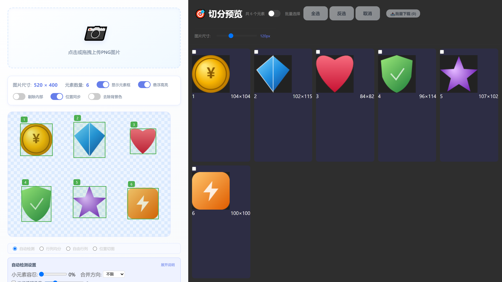
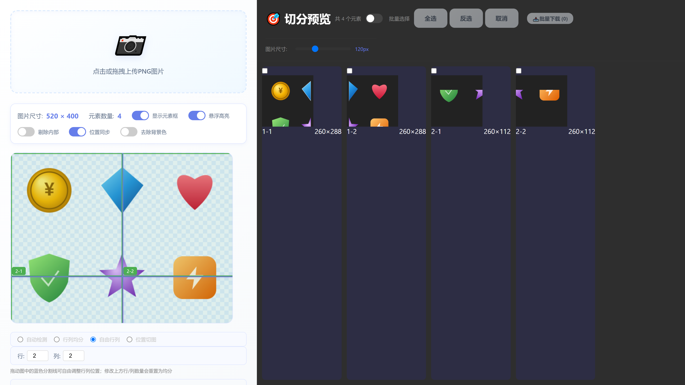
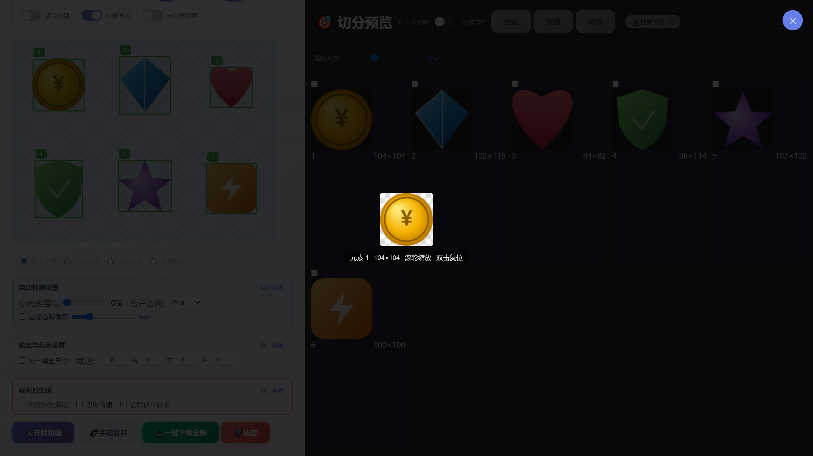

# 图片元素切分工具 (ImageCut)

一个纯前端的图片元素切分工具：上传一张整图（如 UI 素材图、图标集、精灵图），自动或手动切分成若干独立图片，并批量导出为 ZIP。无需后端、无需构建工具，用浏览器打开即可运行。



## 快速开始

因为项目使用原生 ES Module，**直接双击 `index.html`（`file://`）会被浏览器的 CORS 策略拦截**，需要用本地服务器访问：

```bash
# 方式一：使用自带的启动脚本（Windows，需已安装 Python）
start_server.bat

# 方式二：任意静态服务器
python -m http.server 8000
npx serve .
```

然后访问 `http://localhost:8000`，把 PNG 拖进上传区即可。

## 功能说明

### 四种切图模式

| 模式 | 说明 |
| --- | --- |
| **自动检测** | 扫描 alpha 通道，按连通区域自动识别图中每个元素并生成边界框 |
| **行列均分** | 按指定行数 / 列数把整张图均分 |
| **自由行列** | 在画布上直接拖拽蓝色分割线，自由调整行列位置，实现不均分切图 |
| **位置切图** | 指定宽高，在画布上点击任意位置，以该点为中心切出一块 |

自由行列模式下拖动分割线即可调整，修改上方行 / 列数量会重置为均分：



### 自动检测设置

- **小元素容忍**：设定比例阈值（0–100%），小于该比例的小元素会被合并到附近的大元素中，而不是单独切出，避免把装饰性小碎块切成一堆碎片。
- **合并方向**：控制小元素优先向横向（行）还是纵向（列）的大元素合并；`不限` 则按相对距离取最近。
- **边缘透明像素**：为每个切图元素四周补一圈透明像素，避免裁切过紧。

### 输出与裁剪设置

- **统一输出尺寸**：勾选后所有切图统一为指定宽高，元素等比缩放居中；留空（0）则自动取最大元素尺寸。
- **裁边（上 / 右 / 下 / 左）**：切图前先把原图四边各裁掉指定像素，用于去除边框、水印等。

### 裁剪后处理

- **去除外延描边**：把每张切图里非透明图形最外圈 N 像素变透明，去掉外延描边与杂色，**输出尺寸不变**。剥边带做了 1px 羽化，避免出现锯齿感。
- **边缘内缩**：把裁剪区域四边各向内裁掉 N 像素，直接切掉边缘杂色，**输出尺寸随之变小**。
- **剔除孤立像素**：只保留连续的主体外轮廓（最大连通块），剔除元素范围内的孤立杂点 / 杂色。

### 其他

- **去除背景色**：选取背景色并设置容差，支持「仅扣除边缘」或「扣除全局」，可实时预览效果。
- **手动合并**：进入手动合并模式后点选多个元素框，合并为一个切图。
- **放大预览**：右键预览项右上角的 🔍 打开全屏预览，支持滚轮缩放、拖拽平移、双击复位，`Esc` 关闭。



- **批量选择**：开启后可用框选 / 全选 / 反选挑选元素，仅导出选中的部分。
- **导出**：`一键下载全部` 导出整包 ZIP，`批量下载` 只导出选中项，点击缩略图可下载单张。

## 项目结构

```
切图/
├── index.html          # 页面结构
├── reset.css           # 样式重置
├── layout.css          # 整体布局
├── components.css      # 组件样式
├── utils.css           # 工具类样式
├── start_server.bat    # 本地服务器启动脚本
├── screenshots/        # 文档截图与演示素材
└── js/
    ├── app.js          # 主入口，事件绑定与流程编排
    ├── state.js        # 全局状态
    ├── elements.js     # DOM 元素引用
    ├── config.js       # 常量配置（alpha 阈值、最小元素尺寸）
    ├── image.js        # 图片加载、画布显示、背景色去除
    ├── detection.js    # 元素检测与各类切图算法
    ├── ui.js           # 绘制、叠加层交互、放大预览
    ├── selection.js    # 批量选择
    └── download.js     # ZIP 导出
```

## 技术要点

- **零依赖、零构建**：原生 ES Module，无需 npm / webpack / vite，克隆后用静态服务器打开即可。仅导出 ZIP 时从 CDN 加载 JSZip。
- **像素级处理**：基于 Canvas 2D 直接操作 `ImageData`。连通区域识别使用迭代式 8 邻域洪水填充（显式栈，避免递归爆栈）。
- **坐标一致性**：叠加层（元素框、分割线）的定位统一走 `getCanvasDisplayGeometry()`，以画布**真实渲染尺寸**换算显示坐标与图像像素坐标，避免缩放 / 裁剪后显示与实际切图位置错位。
- **抗锯齿剥边**：去描边时先从画布四边洪水填充出背景，再逐轮向前景推进做硬剥边，仅对最外 1px 羽化带做均值，既去杂色又不糊掉内部细节。

## 浏览器支持

需要支持 ES Module、Canvas 2D 与 `DataTransfer` 的现代浏览器（Chrome / Edge / Firefox / Safari 较新版本均可）。若需裁剪非 PNG 图片或导出 JPEG 等格式，可自行扩展 `download.js`。

## 演示素材

`screenshots/demo-sprites.png` 是文档截图所用的演示精灵图（6 个图标，透明背景），可直接拖入工具试用。
